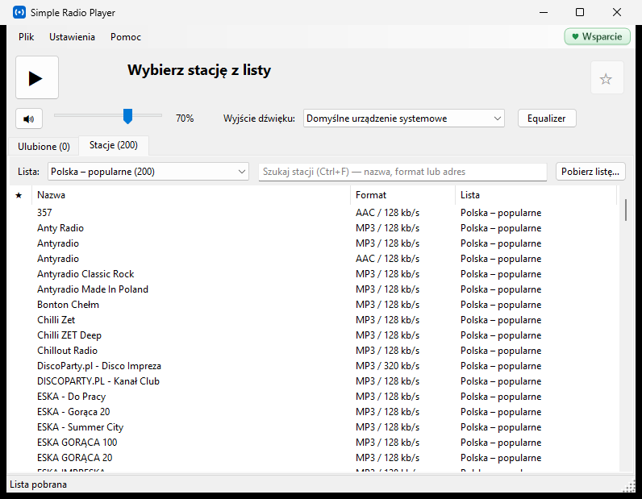

# Simple Radio Player

Prosty odtwarzacz radia internetowego dla Windows — siedzi w trayu, sam startuje z systemem
i gra ostatnią stację na wybranym urządzeniu audio.

## Co potrafi

- **Tray i autostart** — uruchamia się razem z Windows schowany w obszarze powiadomień.
- **Autoodtwarzanie** — przy starcie ostatnio słuchana stacja albo wybrana stacja startowa.
- **Wybór wyjścia dźwięku** — np. radio na głośnikach, a słuchawki wolne do rozmów.
- **Ulubione** na osobnej zakładce, z kolejnością ustalaną przez użytkownika.
- **Listy stacji z bazy [Radio Browser](https://www.radio-browser.info)** — Polska (popularne lub
  wszystkie), dowolny kraj, kategorie (rock, jazz, klasyczna…). Aktualizacja jednym kliknięciem,
  poprzednia wersja listy zostaje jako kopia `.bak`.
- **Własne listy** — import M3U, M3U8, PLS, XSPF, ASX/WAX/WVX i TXT, także przeciągnięciem pliku
  na okno; eksport ulubionych do M3U8.
- **Equalizer** z 18 presetami, **wyrównywanie głośności** między stacjami, głośność zapamiętywana
  osobno dla każdej stacji, przycisk wyciszenia.
- **Tytuł granego utworu** (gdy stacja go nadaje) — dwuklik kopiuje go do schowka.
- **Logotypy stacji** z możliwością wyboru: wszystkie, tylko dobrej jakości albo kafelki z literą.
- **Wersja przenośna** — ustawienia obok programu albo, do wyboru, w profilu użytkownika.
- **Informacja o nowej wersji** — raz na dobę program sprawdza wydania na GitHubie i pokazuje pasek
  z linkiem do pobrania; niczego nie instaluje sam. Można to wyłączyć w Opcjach.

Program startuje bez żadnej listy — nic nie pobiera sam. Listę pobiera się przyciskiem
„Pobierz listę…”, importuje z pliku albo dodaje stacje ręcznie.

## Pobieranie

Gotowe wersje są w zakładce [Releases](https://github.com/zaba44/SimpleRadioPlayer/releases):

| Plik | Dla kogo |
|---|---|
| `x64` | większość komputerów z Windows 10/11 — nie wymaga instalowania .NET |
| `x86` | starsze, 32-bitowe Windows |
| `arm64` | komputery z procesorem ARM (np. Snapdragon) |
| `lite` | najmniejsza; wymaga zainstalowanego [.NET 10 Desktop Runtime](https://dotnet.microsoft.com/download/dotnet/10.0) |

Rozpakuj całe archiwum — obok `SimpleRadioPlayer.exe` musi leżeć folder `libvlc`.

## Budowanie ze źródeł

Wymagany [.NET 10 SDK](https://dotnet.microsoft.com/download/dotnet/10.0). Uruchom `build.bat`
i wybierz wersję. Wyniki trafiają do folderu `output` — **każde budowanie czyści go w całości**.

**Wydanie:** wypchnięcie tagu w postaci `v1.2.3` uruchamia GitHub Actions (`.github/workflows/wydanie.yml`),
które skryptem `wydanie.ps1` budują wszystkie wersje, pakują je do ZIP z sumami SHA-256 i zakładają Release.
Ten sam skrypt działa lokalnie: `powershell -ExecutionPolicy Bypass -File wydanie.ps1 -Wersja 1.2.3`.

## Licencja

Program jest wolnym oprogramowaniem na licencji [GNU GPL v3](LICENSE): można go używać za darmo,
także w firmie i komercyjnie, zmieniać i rozpowszechniać — pod warunkiem, że zmienione wersje
pozostaną otwarte na tej samej licencji. Program jest udostępniany bez jakiejkolwiek gwarancji.

Komponenty innych autorów (LibVLC i LibVLCSharp na licencji LGPL, .NET na licencji MIT) oraz źródła
danych są opisane w [THIRD-PARTY-NOTICES.txt](THIRD-PARTY-NOTICES.txt).

**Źródła danych:** listy stacji pochodzą z otwartej bazy [Radio Browser](https://www.radio-browser.info).
Strumienie należą do nadawców, a logotypy są znakami towarowymi stacji — program pobiera je na
komputerze użytkownika i niczego z tego nie rozpowszechnia.

## Wsparcie

Program jest darmowy i nic nie jest w nim zablokowane. Jeśli Ci się przydaje, możesz dobrowolnie
wesprzeć autora: **[cuplink.to/zaba44](https://cuplink.to/zaba44)** ♥

---

© 2026 Dominik Żabiński
